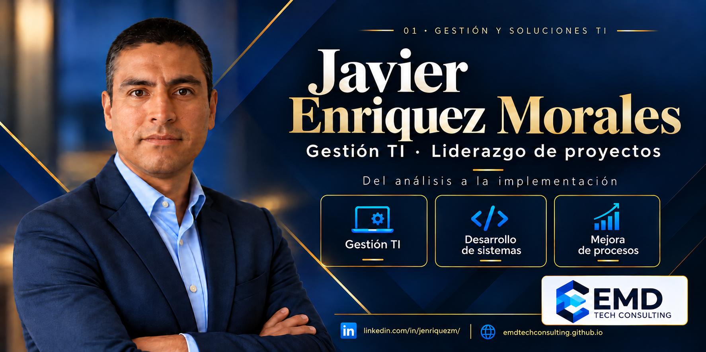

# Javier Enriquez Morales · Portafolio profesional

Gestor de TI y líder de proyectos, con experiencia en análisis, planificación, desarrollo, pruebas, implementación y soporte de soluciones tecnológicas.

Bachiller en Ingeniería Informática por la Universidad Ricardo Palma. Impulsor de EMD Tech Consulting.

**[Visitar mi portafolio](https://emdtechconsulting.github.io/)**

## Proyectos destacados

- [AUREA Laravel Lab](https://github.com/emdtechconsulting/aurea-laravel): sistema de pedidos con Laravel, SQLite, API y pruebas automatizadas.
- [AUREA Full Stack](https://github.com/emdtechconsulting/emd-aurea-fullstack): aplicación con Java, Spring Boot, React y MariaDB.

## Áreas de experiencia

Gestión de TI, liderazgo de proyectos, análisis de requerimientos, desarrollo e integración de sistemas, administración de infraestructura y mejora de procesos.

Este portafolio está construido con HTML, CSS y JavaScript y publicado con GitHub Pages.

## Contacto

[LinkedIn](https://www.linkedin.com/in/jenriquezm/) · [GitHub](https://github.com/emdtechconsulting) · [YouTube](https://www.youtube.com/@EMDTechConsultingOficial) · [WhatsApp](https://wa.me/51943225189)
